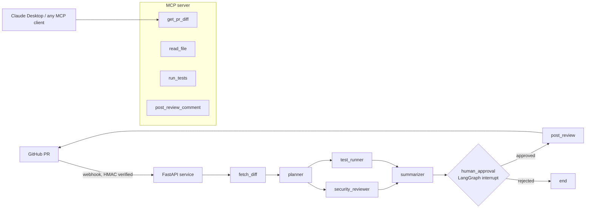

# AgenticLint

> **Production-grade AI code review platform** — multi-agent pull request analysis powered by Claude, LangGraph, MCP, and a modern web dashboard.

AgenticLint reads your pull requests, identifies real bugs and security issues across multiple specialist agents running in parallel, then pauses for a human to approve the review before posting inline comments to GitHub. It ships with a polished dark-mode web dashboard, a CLI, an MCP server for Claude Desktop, and a 30-case evaluation suite.



## What's inside

| Component | Description |
|---|---|
| **Web Dashboard** | Dark-mode SPA served at `GET /` — login, review list with search/filter, detailed findings panel, approve/reject workflow |
| `graph.py` | LangGraph workflow: planner → security reviewer + test runner **in parallel** → summarizer → human approval → post |
| `llm.py` | Explicit Claude tool-calling loop with prompt caching, schema-validated outputs, and per-call token accounting |
| `server.py` | FastAPI webhook service — verifies GitHub HMAC signatures, runs reviews in the background, checkpoints to SQLite |
| `mcp_server.py` | MCP server exposing `get_pr_diff`, `read_file`, `run_tests`, `post_review_comment` over stdio or HTTP |
| `evals/` | 30 seeded-bug PR diffs + eval runner (detection rate, false-positive rate, tokens, cost, p50/p95 latency) |

## Quick start

```bash
git clone https://github.com/AbhayPrasad01/AgenticLint.git && cd AgenticLint
python -m venv .venv && source .venv/bin/activate  # Windows: .venv\Scripts\activate
pip install -e ".[dev]"
cp .env.example .env   # add ANTHROPIC_API_KEY, GITHUB_TOKEN, ADMIN_TOKEN
export $(grep -v '^#' .env | xargs)

pytest -q                                    # 31 tests, no API key needed

# Start the dashboard + API server
ADMIN_TOKEN=your-token uvicorn review_agent.server:create_app --factory --port 8000
# Open http://localhost:8000 → paste your ADMIN_TOKEN → dashboard
```

### CLI

```bash
review-agent review owner/repo#42           # review a PR; asks before posting
review-agent review owner/repo#42 --yes     # post without asking
review-agent review --diff my.diff          # review a local diff, print only
```

### Claude Desktop (MCP)

Add to `claude_desktop_config.json`:

```json
{
  "mcpServers": {
    "agenticlint": {
      "command": "/path/to/.venv/bin/review-agent-mcp",
      "env": { "GITHUB_TOKEN": "ghp_..." }
    }
  }
}
```

Then ask Claude: *"Get the diff for owner/repo PR 3 and point out any security issues."*

## Dashboard

The web dashboard is served at `GET /` by the FastAPI server. It provides:

- **Login** — admin token auth stored in `sessionStorage`
- **Reviews list** — filter by status (awaiting/running/posted/failed), search by repo/PR/summary
- **Review detail** — AI summary, severity-coded findings (critical/high/medium/low), file locations, suggested fixes, token usage stats
- **Approve/Reject workflow** — modal confirmation before anything is posted to GitHub
- **Real-time** — auto-refreshes every 15 s; running-indicator while analysis is in progress

## Evaluation

```bash
python -m evals.run_eval                                    # all 30 cases
python -m evals.run_eval --model claude-haiku-4-5-20251001 --limit 10
python -m evals.run_eval --output-dir ./my-results         # custom output dir
```

Each case is a realistic change with one planted bug (SQL injection, unverified JWTs, TOCTOU races, payment errors, N+1 queries, and more). A bug counts as detected when a comment lands on the right file within ±2 lines of the bug.

## Design decisions

- **Hand-written tool loop** — forced tool use (`tool_choice: any`), schema-validated outputs, errors returned to model, exact token accounting per node. ~100 lines and fully testable with a fake client.
- **Prompt caching** — system prompts are sent as cacheable blocks, cutting input costs on long prompts.
- **Numbered diffs** — each diff line is prefixed with its new-file line number so inline comments land precisely.
- **Human in the loop by default** — graph pauses with `interrupt()` before posting. State is checkpointed to SQLite so reviews survive restarts.
- **Shared SQLite connection + WAL** — prevents write-write conflicts between the LangGraph checkpointer and the ReviewStore under concurrent FastAPI background tasks.
- **Untrusted code** — the test runner only runs inside `REVIEW_WORKDIR`, is off by default, and the server runs as a non-root user in Docker.

## Project layout

```
src/review_agent/
  static/index.html   AgenticLint web dashboard (SPA)
  server.py           FastAPI webhook + approval API + dashboard server
  graph.py            LangGraph multi-agent workflow
  llm.py              Claude tool-calling loop, prompt caching, cost tracking
  schemas.py          Pydantic output models (Plan, Finding, ReviewSummary)
  workspace.py        GitHub and local workspace implementations
  diff.py             Unified diff parsing and line numbering
  tools.py            Sandboxed test runner + MCP tool definitions
  mcp_server.py       MCP server (stdio and HTTP transport)
  cli.py              Command-line interface
evals/                30 seeded-bug eval cases + runner
tests/                Unit tests (fake Claude client, no network needed)
docs/                 Deployment guides
```

## License

MIT
